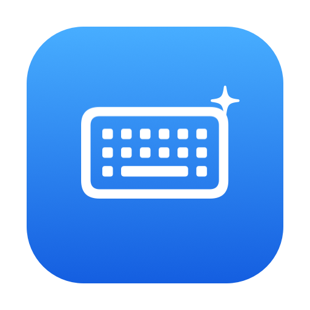
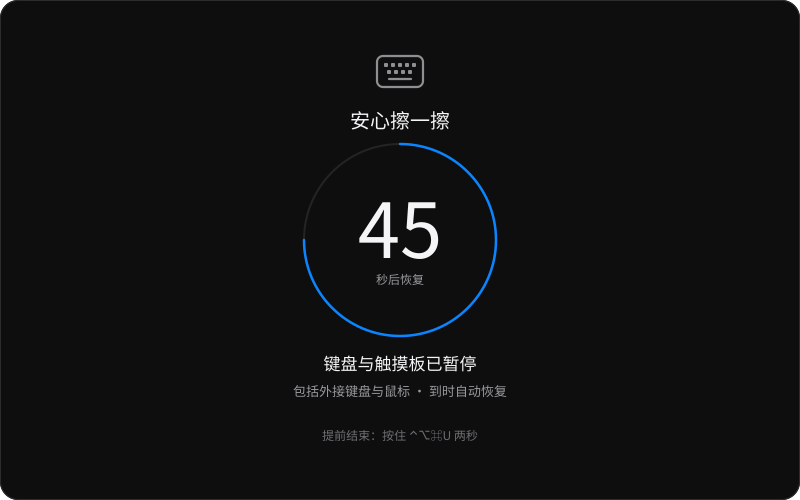
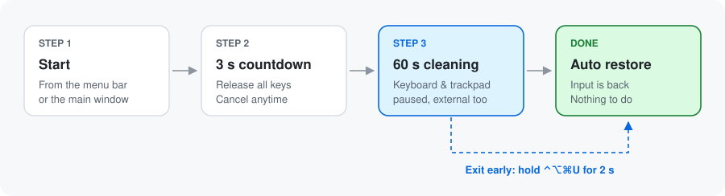
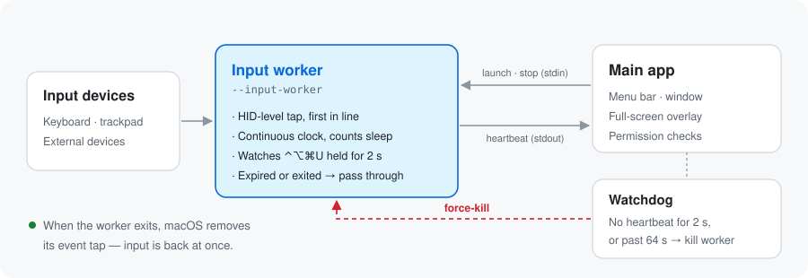

<div align="center">



# BKCleanHelper

**One minute to wipe your Mac clean, worry-free 🧽**

A macOS menu bar utility that pauses your keyboard, trackpad and external mouse/keyboard for 60 seconds so you can wipe them down — then brings input back automatically.

[简体中文](README.md) · **English**


</div>

---

Wiping your keyboard usually means typing gibberish into whatever app is in front. Wiping the trackpad sends the pointer flying and windows switching. BKCleanHelper takes over all input for one minute while you clean — and **always gives it back, no matter what**.

> [!NOTE]
> The app's interface is currently in **Simplified Chinese** only. The button and menu names below are translated for reference.

<p align="center">
  
  <br><sub>The full-screen cleaning overlay (mockup). It reads: “Wipe away — keyboard &amp; trackpad paused — back in 45 s”.</sub>
</p>

## ✨ Features

- ⌨️ **One-click pause**: built-in keyboard, trackpad, external keyboards and mice are all paused
- ⏱️ **Back in 60 seconds**: a separate worker process keeps time, independent of the UI
- 🆘 **Exit early anytime**: hold <kbd>⌃ Control</kbd> <kbd>⌥ Option</kbd> <kbd>⌘ Command</kbd> <kbd>U</kbd> for two seconds
- 🛡️ **Layered fail-safes**: input is released immediately if the app quits, loses contact with the worker, the screen locks, the Mac sleeps or the user switches
- 👀 **Try before you trust**: “Preview” shows the overlay for 8 seconds without any permissions (preview does **not** block input)
- 🍎 **Native**: AppKit, system fonts and SF Symbols, light and dark appearance
- 🔒 **Fully local**: no network, no input logging, no system settings changes, no drivers

## 🚀 Getting started

### 1. Build

Requires macOS 13 or later and the Xcode command line tools with a Swift 6 toolchain (Xcode 16 or later).

```sh
git clone https://github.com/binbinku/BKCleanHelper.git
cd BKCleanHelper
bash scripts/build.sh
```

This produces `outputs/BKCleanHelper.app`. Move it somewhere permanent (e.g. Applications) before granting permissions.

> [!NOTE]
> The build is ad-hoc signed and not notarized by Apple. After rebuilding, replacing or moving the app you may need to grant permissions again. You do **not** need to — and should not — disable SIP or Gatekeeper for it.

### 2. Grant permissions

Open the app and click “Open Settings…” (前往设置…) for each item. In **System Settings → Privacy & Security**, allow BKCleanHelper under:

| Permission | Why |
| --- | --- |
| ♿ Accessibility | Intercept and hold back input events delivered by the system |
| ⌨️ Input Monitoring | Listen to keyboard, mouse and trackpad events (including the exit shortcut) |

Both are required. If either is revoked mid-session, cleaning stops and input is restored right away.

If macOS asks you to quit and reopen the app, do so. Once both show as allowed (已允许), you're ready.

### 3. Clean

<p align="center">
  
</p>

1. Click “Start cleaning” (开始清洁) from the menu bar icon or the main window
2. **Let go of all keys and mouse buttons** — you can still cancel during the 3-second countdown
3. Start wiping once the overlay says the keyboard and trackpad are paused 🧽
4. Input comes back after 60 seconds; to stop early, hold <kbd>⌃</kbd><kbd>⌥</kbd><kbd>⌘</kbd><kbd>U</kbd> for two seconds

Closing the main window keeps the menu bar icon. Quitting the app ends cleaning and restores input immediately.

## 🛡️ Why it won't lock you out

The scary part of any input blocker is getting stuck. BKCleanHelper splits **blocking input** and **drawing the UI** into two processes, and gives every link a way out:

<p align="center">
  
</p>

- A **separate input worker** owns the event tap and the deadline. The deadline uses a continuous clock that keeps counting through sleep, not the UI's timer
- Once the deadline passes, every event **passes straight through** even if a timer fires late — the lock can never be extended
- The tap is released when the main app quits, loses contact, the screen locks, the Mac sleeps or the user switches
- A **watchdog** in the main app kills the worker if it misses heartbeats for 2 seconds or runs past 64 seconds
- When the worker exits, macOS removes its event tap automatically
- The overlay **ignores mouse events**, so the UI itself can never become a second lock
- If permissions are missing or a full tap can't be created, it **refuses to start** rather than showing a fake overlay

## ⚠️ Known limitations

> [!WARNING]
> - The **power / Touch ID button** and hardware force shutdown can't be blocked — avoid them while wiping.
> - The app intercepts input events; it doesn't cut power to the hardware, so the trackpad may still give haptic feedback.
> - Multi-finger system gestures, special function keys, third-party gesture tools and Secure Input situations need to be verified on your own Mac; OS updates or other input tools may change what gets blocked. **Before your first real cleaning**, open a blank document and try normal keys, system shortcuts, trackpad scrolling and multi-finger gestures.
> - If macOS interrupts the event tap mid-session, the session ends immediately and tells you to stop wiping.

## 🔒 Privacy

- 🚫 No network access
- 🚫 Never records or replays input
- 🚫 Doesn't change keyboard or trackpad settings
- 🚫 No drivers or privileged background services

## ❓ FAQ

<details>
<summary><b>What if I really get stuck?</b></summary>

Try in this order:

1. Wait: input always comes back after 60 seconds (the watchdog's hard limit is 64 seconds)
2. Hold <kbd>⌃</kbd><kbd>⌥</kbd><kbd>⌘</kbd><kbd>U</kbd> for two seconds
3. Close the lid or put the Mac to sleep — locking and sleeping both release the tap
4. Last resort: hold the power button to force shut down (the power button is never blocked)

</details>

<details>
<summary><b>Permissions show as not granted after a rebuild?</b></summary>

macOS may treat each ad-hoc signed build as a new app. In **System Settings → Privacy & Security**, remove the old BKCleanHelper entries under Accessibility and Input Monitoring, then add the app again.

</details>

<details>
<summary><b>Why does it ask me to let go of all keys?</b></summary>

If a key or mouse button is still down when the tap starts, its “release” event would be swallowed and macOS would think it's held forever. So after the countdown, BKCleanHelper waits until everything is released; if that takes more than 8 seconds, the session is cancelled.

</details>

<details>
<summary><b>Does it work on Intel Macs?</b></summary>

`build.sh` builds for the current machine's architecture (not a universal binary). It should build and run on any Mac with macOS 13+, but please verify on real hardware — reports are welcome 🙌

</details>

## 🛠️ Development

```text
.
├── Sources/
│   ├── BKCleanHelper/      # The app: menu bar, main window, overlay, input worker (target keeps its early name)
│   └── CleanCore/      # Pure logic: deadline, early-exit detection, heartbeat & watchdog
├── Tests/CleanCoreTests/
├── Resources/Info.plist
├── scripts/
│   ├── build.sh        # Build the .app, generate the icon, ad-hoc sign and zip
│   ├── check.sh        # Unit tests + simulated worker tests
│   ├── test_worker.py
│   ├── Icon.swift      # App icon generator
│   └── package_icon.py
└── Package.swift
```

```sh
bash scripts/check.sh   # tests
bash scripts/build.sh   # builds outputs/BKCleanHelper.app
```

You can open `Package.swift` in Xcode to read and debug the code; for everyday use, run the built `.app` so permissions stay attached to a stable app.

🧪 The simulated tests do **not** actually block input. They cover: exact deadlines, continuous hold for early exit, repeated stop, parent disconnect, resuming a suspended worker, broken output pipes and invalid commands.

<details>
<summary><b>📋 Real-hardware checklist</b></summary>

Real input blocking needs permissions granted by hand, so simulated tests can't replace testing on a real Mac. Before a release, check:

- [ ] Regular keys and modifier keys
- [ ] <kbd>⌘</kbd><kbd>Tab</kbd>, <kbd>⌘</kbd><kbd>Space</kbd>
- [ ] Volume and brightness keys
- [ ] Pointer movement, click, drag
- [ ] Two-finger scroll, zoom, rotate
- [ ] Three- and four-finger gestures
- [ ] External keyboard and mouse
- [ ] Automatic restore after 60 s
- [ ] Early exit with <kbd>⌃</kbd><kbd>⌥</kbd><kbd>⌘</kbd><kbd>U</kbd>
- [ ] Revoking a permission mid-session
- [ ] Normal quit and crash
- [ ] Sleep and wake
- [ ] Multiple displays

</details>

## 🤝 Contributing

Issues and pull requests are welcome!

- 🐛 When reporting a bug, include your macOS version, Mac model and whether external input devices were connected
- 🔧 Run `bash scripts/check.sh` before submitting code
- ⌨️ For changes that touch input blocking, please run through the checklist above on a real Mac

## 📄 License

Released under the [MIT License](LICENSE).
